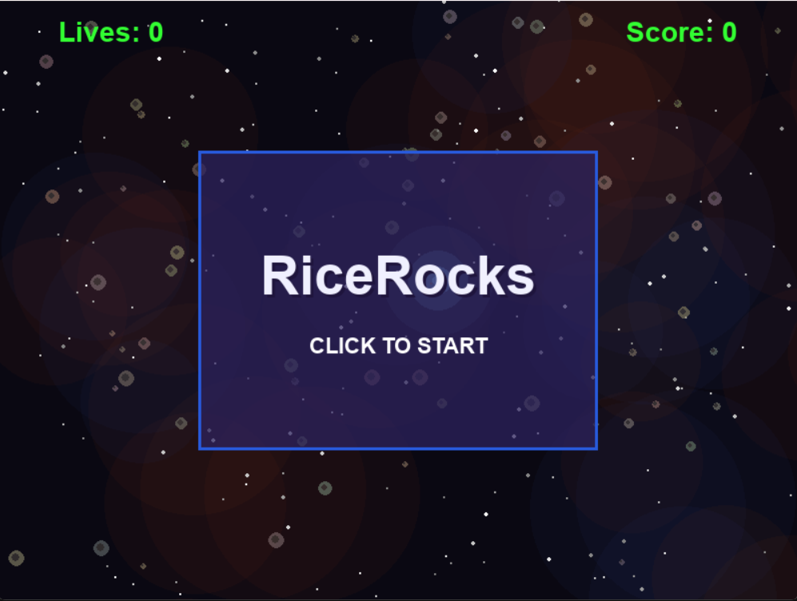
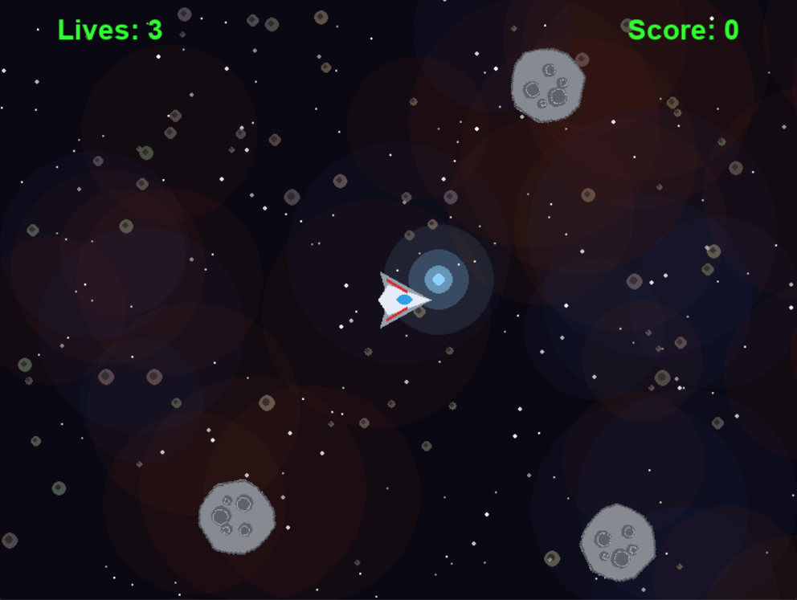

# Игра «Астероиды»
**Автор:** Власова Радмила Игоревна  
**Группа:** ПИ25-1
**Дисциплина:** Практикум по программированию  
**Дата сдачи:** 25.11.2026  

## Описание проекта
Двумерная аркадная игра «Астероиды» с тайловой анимацией и тороидальной геометрией игрового поля. Игрок управляет космическим кораблем с инерционной физикой, вращает его, включает маршевый двигатель и уничтожает вращающиеся астероиды ракетами с ограниченным временем жизни.

## Функциональные возможности
### Основной функционал
- Двухслойный космический фон: статичная туманность и динамический слой движущихся влево обломков
- Интерактивная стартовая заставка `RiceRocks` с запуском игры только по клику внутри её области
- Инерционное управление кораблем: вращение вокруг центра, ускорение со сменой спрайта двигателя и плавное торможение в среде
- Тороидальная геометрия поля: бесшовный переход объектов через противоположные границы экрана
- Покадровая (тайловая) анимация взрывов при попадании ракет в астероиды и столкновении с кораблем

### Дополнительный функционал
- Система жизней (`Lives: 3`), подсчет очков (`Score`) и автоматическое возвращение к заставке после окончания игры

## Демонстрация работы программы
### Начальный экран с заставкой


### Игровой процесс


## Требования к системе
- **Python:** 3.9 или выше
- **Операционная система:** Windows / macOS / Linux
- **Библиотеки:** `pygame` (точная версия зафиксирована в `requirements.txt`)

## Установка и запуск

### 1. Клонирование репозитория
```bash
git clone https://github.com/radmilavlasova/asteroids_game.git
cd asteroids_game
```

### 2. Активация виртуального окружения
**Windows (CMD / PowerShell):**
```bash
venv\Scripts\activate
```

**Windows (Git Bash) / macOS / Linux:**
```bash
source venv/Scripts/activate
```

### 3. Установка зависимостей
```bash
python -m pip install -r requirements.txt
```

### 4. Запуск программы
```bash
python main.py
```

### 5. Управление в игре
- **ЛКМ по заставке** — старт / перезапуск игры
- **Стрелки влево / вправо** — вращение корабля
- **Стрелка вверх** — включение двигателя (ускорение)
- **Space (Пробел)** — выстрел ракетой
- **ESC** — выход из приложения

## Структура проекта
```text
asteroids_game/
├── .gitignore
├── README.md
├── requirements.txt
├── main.py
├── screenshots/
│   ├── start_screen.png
│   └── gameplay.png
├── venv/
└── src/
    ├── __init__.py
    ├── app.py
    ├── assets.py
    ├── config.py
    ├── models/
    │   ├── __init__.py
    │   └── model.py
    └── renderers/
        ├── __init__.py
        └── renderer.py
```

**Обоснование архитектуры и назначение модулей:**
Проект построен по объектно-ориентированному принципу с разделением на конфигурацию, графические ресурсы, физическую модель и рендерер (MVC).
- `main.py` — точка входа в приложение.
- `src/config.py` — глобальные параметры окна, физики корабля, скорости ракет и астероидов.
- `src/assets.py` — класс `Assets`, отвечающий за генерацию спрайтов, слоев фона, заставки и тайлсета взрыва.
- `src/app.py` — класс `App`, обрабатывающий события мыши, клавиатуры и главный игровой цикл.
- `src/models/model.py` — иерархия классов `SpaceObject`, `Ship`, `Asteroid`, `Missile`, `Explosion` и `GameModel` с математикой движения и коллизий.
- `src/renderers/renderer.py` — класс `Renderer`, реализующий отрисовку слоев фона, повернутых спрайтов, тайлов взрыва и интерфейса.
